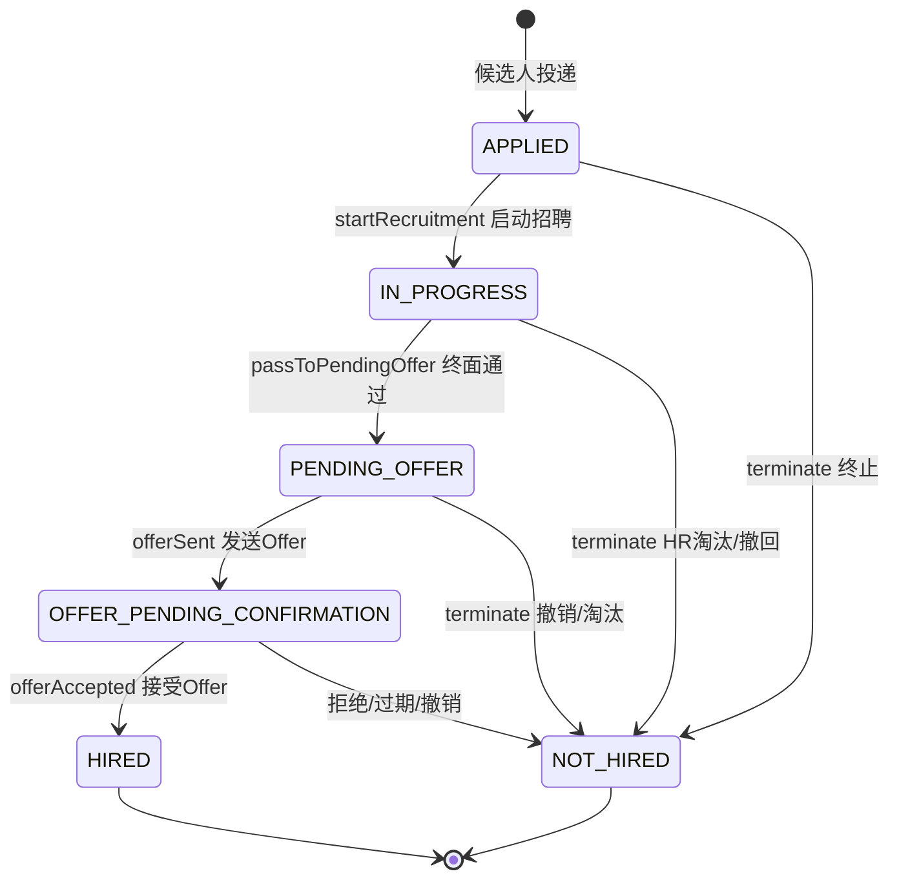

# 岗位投递状态重构 修改报告

- 项目：Intelligent-Interviewer-System
- 分支：feature/eapp-core-services-zx
- 日期：2026-11-05
- 目标：将 `t_app_record.app_status` 由旧 13 态（0–12）重构为 6 个整体招聘阶段；删除待筛选/初筛通过/初筛淘汰三态及全部 AI 评分自动淘汰逻辑（AI 简历分析/评分/报告保留，仅作 HR 参考）；笔试/面试节点级状态与整体阶段分离；`tal_status` 不再镜像任一投递。

---

## 1. 新六态定义（码值固定，禁止改码值）

| 码值 | 枚举 | 中文 | 是否终态 |
|---|---|---|---|
| 0 | APPLIED | 已投递 | 否 |
| 1 | IN_PROGRESS | 招聘中 | 否 |
| 2 | PENDING_OFFER | 待发Offer | 否 |
| 3 | OFFER_PENDING_CONFIRMATION | 待确认Offer | 否 |
| 4 | HIRED | 已录用 | 是 |
| 5 | NOT_HIRED | 未录用 | 是 |

终止原因（`end_reason`，仅 app_status=5 可填，落库为枚举名字符串）：

| 枚举 | 含义 | 操作人要求 |
|---|---|---|
| HR_REJECTED | HR 主动淘汰 | 必须有操作人 |
| CANDIDATE_WITHDRAWN | 候选人撤回 | — |
| OFFER_REJECTED | 候选人拒绝 Offer | — |
| OFFER_EXPIRED | Offer 超时未确认 | — |
| OFFER_CANCELLED | HR 撤销 Offer | 必须有操作人 |
| LEGACY_SCREENING_REJECTED | 历史初筛淘汰迁移标记 | 新流程不再产生 |

---

## 2. 新状态流转图（Mermaid）

说明：笔试/面试的每一轮不再对应整体阶段码，而是在 `t_process_instance_stage` 中生成独立节点实例（按 `pis_ref_id` 幂等、按节点类型自动分组轮次）；整体阶段只在关键业务节点（启动招聘、终面通过、Offer 发送/接受、终止）翻转。

---

## 3. 后端状态机设计

### 3.1 唯一合法变更入口
新增 `ApplicationStatusService`（`ruoyi-system`）作为 `app_status` 唯一合法写入入口，业务域不再直接 `update t_app_record set app_status`。

- 内置合法流转表：
  - APPLIED → IN_PROGRESS / NOT_HIRED
  - IN_PROGRESS → PENDING_OFFER / NOT_HIRED
  - PENDING_OFFER → OFFER_PENDING_CONFIRMATION / NOT_HIRED
  - OFFER_PENDING_CONFIRMATION → HIRED / NOT_HIRED
- 并发与终态保护：行锁 `SELECT ... FOR UPDATE` + 条件更新 `WHERE app_status=from`，并发更新影响 0 行时抛出异常；终态不可再推进。
- 幂等：相同目标重复提交不重复写日志、不报错。
- 终止字段校验：HR_REJECTED / OFFER_CANCELLED 必须有操作人；只有进入 NOT_HIRED 才能写终止原因；未录用必须带原因。
- 每次变更写状态日志 `t_app_status_log`，并对流程实例做 `pin_status` 收尾（未录用=3、已录用=1）。
- 语义方法：`startRecruitment / passToPendingOffer / offerSent / offerAccepted / terminate / withdraw`，及 `SOURCE_*` 来源常量。

### 3.2 节点级状态（笔试/面试）
激活既有空表 `t_process_instance_stage`，新增 `ProcessStageInstance` 领域类与 `ProcessStageInstanceService`：

- `getOrCreate` 按 `refId`（笔试 erc_id / 面试 apt_id）幂等；`createNode` 自动计算同类型分组轮次（第 N 轮）。
- `start / complete / cancel` 驱动节点；`getCurrentNode / currentNodeLabel` 生成「第 N 轮笔试进行中」等仅展示文案。
- AI 分析为纯计算，不产生节点实例。

### 3.3 tal_status 解耦
- `tal_status` 保留 11 码、不删字段，但不再把单条投递的 `app_status` 镜像为全局 `tal_status`。
- `TalStatusService.change` 增加终态聚合守卫：目标为 TAL_REJECTED(3)/TAL_OFFERED(4) 时，先查该候选人除触发岗位外的活跃投递（`app_status in (0,1,2,3)`）；仍有活跃投递则跳过全局翻转，仅写状态日志并收尾本岗位流程实例，满足多岗位独立。

### 3.4 各业务域改造
- 笔试域：删除 6 处自动推进/淘汰（通知推送、开考、定时结算、超时未交、终判按通过与否写状态）；缺考/未通过只写节点结果；HR 第一场笔试且投递为 APPLIED 才 `startRecruitment`。
- 初筛 AI 域：AI 评分只回写 `app_matched_score`，不再按阈值写状态；HR 通过不改投递（仅参考），HR 驳回走 `terminate(HR_REJECTED)`。
- 面试/Offer 域：安排面试建独立节点、APPLIED 才启动招聘；终面通过 `passToPendingOffer`、驳回 `terminate`；Offer accept/reject/expire/withdraw 分别落 `offerAccepted` 或对应 `terminate`；仅在邮件真正发送成功后才 `offerSent`；笔试前置闸门改为查 RESULT_PASS 节点。
- 人才/统计：Dashboard/EnterpriseJob/AgentApplication/AppJob 等漏斗与列表 SQL 全部改为按 `app_status` 新六态聚合，不再读全局 `tal_status`；撤回改走状态机。
- 批量更新收口：HR 批量改投递由单条直写 UPDATE 重写为逐条经状态机流转（终态/非法/并发行跳过并汇总 skipped）。
- 新增单条淘汰端点：`PUT /enterprise/talent/applications/terminate`（body：candidateId、positionId、endReason），按候选人+岗位定位后经状态机终止。

---

## 4. 数据库结构调整与迁移脚本（可回滚）

脚本位于 `backend/doc/`，已在隔离 MySQL 8 端到端验证（含幂等、回滚），隔离实例验证后已拆除，未对生产库执行。

| 文件 | 内容 |
|---|---|
| `migration_app_status_refactor_ddl_20261105.sql` | 幂等 DDL：`t_app_record` 加 end_reason/ended_at/ended_by/end_remark；建 `t_app_status_log`；激活 `t_process_instance_stage`（加 pis_node_type/pis_round/pis_result/pis_ref_id/pis_node_name，放开 pis_stage_id 可空） |
| `migration_app_status_refactor_data_20261105.sql` | 备份驱动数据迁移：先备份 `bak_app_record_20261105`，所有 UPDATE 按备份原始状态分类，避免新旧码 0–5 区间重叠导致的二次覆盖；含人工核查台账与核对 |
| `rollback_app_status_refactor_20261105.sql` | 按备份 REPLACE 恢复全部旧 13 态，并移除新增字段/表 |

验证中发现并修复的真实缺陷：新码与旧码在 0–5 区间重叠，按「当前状态」分类会让已迁移成新码 5 的旧初筛淘汰行被后续「旧码 5（笔试中）」语句再次命中覆盖；改为全部 JOIN 备份表、按原始状态分类后，13 个旧状态播种重验最终分布 0:1、1:7、2:1、4:1、5:3，legacy_rows=0、reason_violation=0，重复执行幂等一致。

---

## 5. 删除的 AI 自动淘汰/自动改状态清单

- `ScreeningServiceImpl.runScreening`：删除按阈值 `score>=60` 自动写 1/2 的整段。
- `ScreeningServiceImpl.syncScreenedApplications`：删除按 AI 分自动淘汰，改为只回写评分。
- `ScreeningServiceImpl.reviewResult`：删除人工评分按阈值自动改状态、HR 通过直接写 1、HR 驳回直接写 2；驳回改为状态机 `terminate(HR_REJECTED)`。
- Mapper 删除语句：`updateApplicationByCandidate`、`updateApplicationStatusByCandidate`、`updateApplicationScreened`，以及零调用的 `advanceApplicationStatus`。
- 面试调度 Mapper 删除 8 个零调用死方法（countValidAppointmentsExcluding、countCompletedSessions、selectProcessInstanceStatus、selectTalStatus、selectApplicationStatus、selectPriorTalStatus、restoreTalStatus、restoreApplicationStatus）。
- 人才库 Mapper 删除直改方法 `updateApplicationStatus`。
- 保留：AI 简历分析、评分（`app_matched_score`）、推荐报告、招呼语、PASS_THRESHOLD 展示位，全部仅作 HR 参考。

---

## 6. 前端改造

### 6.1 e-app（Flutter 企业端，重点）
- 新建 `lib/core/constants/application_status.dart`：统一六态标签/颜色/终态判断、终止原因、「招聘中·当前环节」旁注组件。
- 13 个文件改造：按钮按状态重排，终态行禁止推进；HR 淘汰二次确认 + 原因下拉。
- 本次收口：HR 淘汰按钮由 snackbar 占位改为调用真实端点 `PUT /enterprise/talent/applications/terminate`（`talent_api.dart` 新增 `terminateTalentApplication`），成功后刷新工作流并回调；异常经 ApiException 友好提示。
- `flutter analyze`：仅 1 个改动前已存在 info（reschedule_review_page.dart:59），0 新增。

### 6.2 Vue 双端
- enterprise_pc：新建 `appStatus.js` 共享模块，改 9 文件（批量终态拦截、未录用强制原因、环节旁注）。
- admin_pc：改 6 文件含 mock 数据六态。
- 两工程无 node_modules，仅做 `node --check` 与引用核对，未跑 build。

### 6.3 候选人端
- c-app（Flutter）零改动（后端驱动）；user-PC（Vue）仅对静态时间线与 mock 答复做最小文案修改（去「企业初筛/简历初筛」措辞）。

---

## 7. 测试结果

| 测试类 | 用例数 | 结果 |
|---|---|---|
| ApplicationStatusServiceTest（新建） | 11 | 全通过 |
| ScreeningServiceImplTest（按新口径重写） | 24 | 全通过 |
| 合计 | 35 | Failures=0, Errors=0 |

覆盖：完整录用链路、终态保护、非法跳变、幂等、HR 终止写字段、无原因/无操作人/非未录用带原因三类校验、撤回、记录不存在、并发更新 0；以及 AI 只写评分不写状态。

- 后端全 7 模块离线构建：`mvn -o ...` BUILD SUCCESS。
- 迁移三件套：隔离 MySQL 8 端到端验证（幂等、回滚）通过。

---

## 8. 遗留问题与兼容性风险

1. 历史 `app_process_instance_id` 为空时节点被静默跳过（try/catch），需结合已有 `migration_backfill_process_instances_20261027.sql` 回填。
2. HR 未发通知直接开考，投递可停留在 APPLIED（符合口径，需 HR 知晓）。
3. 求职者端域对象未暴露 endReason，撤回后统一显示「未录用」，无法在候选人端区分撤回与 HR 淘汰；待域对象补 endReason 后细化。
4. `AgentApplicationMapper.withdrawApplication` 保留为只读 select 占位（接口非本次归属，业务已不调用），建议接口维护方后续删除。
5. 漏斗为「当前所处阶段」口径（非累计），如需累计需基于 `t_app_status_log` 另行聚合。
6. Vue 两工程无 node_modules 未跑 build；Offer 拒绝/过期、多轮级联、多岗位独立、笔试未过继续招聘等场景由代码审查 + 状态机单测 + 迁移验证支撑，未做真实库集成测试（生产库受保护，迁移仅交付脚本不执行）。
7. 历史旧 7/8（笔试未通过/缺考）无明确 HR 终止记录者进人工核查台账、不伪造原因；旧初筛淘汰保留 LEGACY_SCREENING_REJECTED 标记。
8. 前端漏斗/统计的部分数值字段仍待后端按六阶段口径完全对齐（标签已改，数值以后端重算为准）。
9. e-app「启动招聘/发Offer/撤销Offer」等快捷项仍可经邀请面试、Offer 页等既有真实功能完成，独立快捷入口后续再补。

---

## 9. 交付文件位置索引

- 基础层：`ruoyi-common/.../enums/ApplicationStatus.java`、`ApplicationEndReason.java`；`ruoyi-system/.../service/ApplicationStatusService.java`、`.../service/ProcessStageInstanceService.java` 及对应 Mapper/XML/domain。
- 迁移与回滚：`backend/doc/migration_app_status_refactor_*.sql`、`rollback_app_status_refactor_20261105.sql`。
- 测试：`ruoyi-system/src/test/.../ApplicationStatusServiceTest.java`、`.../impl/ScreeningServiceImplTest.java`。
