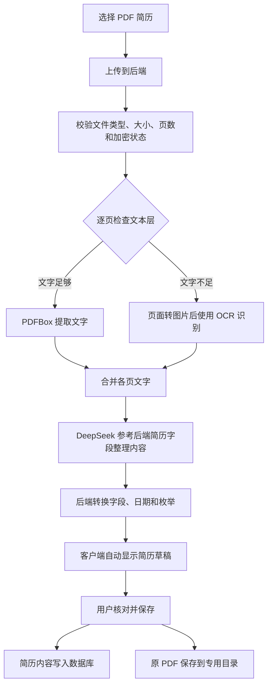

# 简历上传、解析与编排原理

本文说明当前 C-APP 的 PDF 简历导入流程：上传文件后，后端提取文字，调用 DeepSeek 按简历字段整理，客户端自动显示整理后的经历，用户核对并保存。

## 1. 整体流程



解析阶段返回草稿，不创建正式简历记录，也不把原 PDF 持久保存到后端目录。用户点击保存后，才提交简历内容和原文件进行保存。

## 2. 上传：把 PDF 交给后端

客户端选择文件后，通过 `POST /app/resumes/parse-pdf` 上传 PDF，请求使用 `multipart/form-data`，文件字段名为 `file`，同时携带登录凭证。

后端检查文件头、大小、页数、是否加密以及是否能够读取。默认限制为 **10MB、1～8 页**。

上传成功后，后端继续完成文字提取和 AI 整理，再把草稿返回客户端。客户端保留所选文件，以便用户确认保存时提交原 PDF。

## 3. 解析：从页面中取得文字

当前解析器使用 **PDFBox + Tesseract OCR**，默认采用 `AUTO` 模式，逐页选择处理方式。

| 模式 | 处理方式 | 适用情况 |
| --- | --- | --- |
| `AUTO` | 先提取文本层；该页非空白文字少于默认 80 个字符时，改用 OCR | 普通 PDF、扫描 PDF、两者混合的文件 |
| `TEXT` | 只读取 PDF 中的文本层 | 有可用文本层的 PDF |
| `OCR` | 每页转换成图片后识别文字 | 需要强制重新识别的 PDF |

Word 等软件导出的 PDF 通常包含文本层，PDFBox 可以直接提取文字。扫描件或图片形式的页面需要先渲染成图片，再由 Tesseract 识别。默认渲染精度为 220 DPI，语言模型为简体中文和英文。

这一阶段的产物是一段合并后的文字。它可能仍有换行、顺序或识别错误，还没有被整理成教育、工作、项目等简历字段。当前代码尚未接入 Pandoc。

## 4. 编排：让 AI 按后端字段理解内容

后端调用 DeepSeek 的 `deepseek-chat`，发送以下两部分内容：

- PDF 提取或 OCR 识别得到的文字。
- 后端支持的简历字段、枚举含义和整理规则。

发送给模型的是提取后的文字。原 PDF 由本地后端处理，当前编排请求不上传 PDF 文件本身。

AI 根据内容语义判断归属，因此不要求原简历使用固定标题或固定顺序。

| 简历中的表达 | 对应模块 | 主要字段 |
| --- | --- | --- |
| 学术背景、求学经历、教育背景 | 教育经历 `educations` | 学校、专业、学历、起止日期、绩点、描述 |
| 职业履历、任职经历、实习经验 | 工作经历 `works` | 公司、职位、部门、起止日期、是否在职、工作描述 |
| 项目实践、项目成果、项目经验 | 项目经历 `projects` | 项目名称、角色、起止日期、描述、技术栈 |
| 专业能力、技术能力、技能特长 | 技能 `skills` | 技能名称、熟练程度 |
| 期望岗位、求职意向 | 求职方向 `jobDirection` | 期望从事的岗位方向 |

例如，下列虚构文字：

```text
教育背景：示例大学，计算机科学与技术，本科，2020.09—2024.06
实习经验：示例科技公司，后端开发实习生，负责接口开发与维护
```

会被整理为一条教育经历和一条工作经历。学校、专业、学历、公司、职位和职责分别进入对应字段，页面据此生成卡片。

模型通过 JSON 返回结果。提示词要求只整理原文中明确存在的信息：缺失内容使用空值，不补造学校、公司、日期、学历或技能水平。模型不能决定用户归属、数据库记录 ID 或文件存储路径。

## 5. 后端转换与自动填写

AI 返回结果后，后端将其转换成 `AppResume` 简历对象，再交给客户端。转换过程兼容常见格式差异：

- 字段名称：接受约定字段、常见别名、部分中文名称及数据库列名。
- 日期：接受年份、年月、中文日期、点号或斜杠分隔的日期；缺少月、日时按规则补为 `01`，原文精度仍需核对。
- 学历与技能水平：将“本科”等明确表达转换为系统使用的枚举值，无法确定时留空。
- 经历集合：兼容单条对象和数组；技能也可以从字符串拆分。
- 局部异常：个别字段无法转换时尽量保留原值，让其他可用经历继续填入。

无法归入现有字段的内容通过 `unmappedText` 返回，页面显示为“其他简历内容”。超过字段长度的内容会保留补充信息，原 PDF 也可以在保存后留作核对依据。

客户端收到草稿后，直接使用 `educations`、`works`、`projects` 和 `skills` 显示各类经历。原文中已识别出的经历会自动填入，用户主要进行核对和必要修正。

这里的“编排”由模型理解内容、后端转换结果、客户端展示三个环节共同完成。模型返回数据，数据库写入由后端业务代码执行。

## 6. 失败与重试

如果模型响应无法解析，或没有任何可填入的教育、工作、项目、技能条目，后端会根据原文和字段要求自动修正重试一次。

网络超时、鉴权失败、服务限流等错误会返回失败，不属于上述内容修正重试。最终失败时，客户端保留所选 PDF 的重试入口。

OCR 识别和 AI 整理都可能出现遗漏或误判，尤其是扫描模糊、多栏排版或原文缺失时，所以导入完成后保留用户核对步骤。

## 7. 保存：数据库内容与原 PDF 分开存放

用户点击保存后，客户端再次提交原 PDF，同时提交核对后的简历 JSON。这个步骤保存已有整理结果，不重新调用 AI。

| 保存对象 | 位置 | 内容 |
| --- | --- | --- |
| 简历主体 | `t_res_base` | 简历名称、求职方向等信息，以及附件引用、文件名和大小 |
| 教育经历 | `t_res_education` | 学校、专业、学历、时间等 |
| 工作经历 | `t_res_work` | 公司、职位、工作内容等 |
| 项目经历 | `t_res_project` | 项目名称、角色、描述、技术栈等 |
| 技能 | `t_res_skill` | 技能名称、熟练程度 |
| 原 PDF | 后端专用文件目录 | 上传的原始文件字节 |

默认文件根目录为 `ruoyi.profile` 上传目录旁的 `resume-pdf`，目录结构为：

```text
resume-pdf/
└── <用户ID>/
    └── <年>/<月>/<日>/
        └── <随机文件名>.pdf
```

数据库保存文件引用，文件内容保存在磁盘。读取 PDF 时，后端先校验当前用户是否拥有该简历，再返回文件。

普通编辑会保留已有 PDF。替换 PDF 时，数据库事务成功后清理旧文件；事务回滚时清理新文件。

识别原文、`unmappedText` 和解析提示目前属于草稿辅助信息，不单独持久化到简历表。需要作为简历字段长期使用的补充内容，应在保存前放入对应经历描述；原文件内容随 PDF 保留。

## 8. 接口与配置入口

| 方法 | 接口 | 用途 |
| --- | --- | --- |
| POST | `/app/resumes/parse-pdf` | 提取文字、调用 AI，返回简历草稿 |
| POST | `/app/resumes/import-pdf` | 创建简历并保存原 PDF |
| POST | `/app/resumes/{resumeId}/import-pdf` | 更新简历并替换原 PDF |
| GET | `/app/resumes/{resumeId}/pdf` | 校验归属后读取原 PDF |

默认配置集中在 [resume-pdf.properties](../backend/ruoyi-system/src/main/resources/resume-pdf.properties)，包括解析模式、文件目录、文件限制、模型地址、模型名称和超时。本机密钥填写在 Git 忽略的 `backend/config/application.yml` 中的 `app.resume.structure.api-key`；从 `backend/` 启动后端时自动加载，填写后重启即可，无需重新打包。可提交的空配置示例见 [application.example.yml](../backend/config/application.example.yml)。环境变量仍可用于其他部署环境；实际密钥不写入客户端、示例或文档。

目前通过后端配置调整，管理员页面尚未接入。默认开启 AI 编排；后端保留关闭 AI 后的规则解析分支，但当前客户端的 PDF 自动导入入口要求 AI 编排结果，关闭 AI 不等同于客户端可正常使用纯规则导入。

更多部署参数和验证说明见 [PDF 简历解析与存储](PDF简历解析与存储.md)。

## 9. 主要代码位置

| 代码 | 职责 |
| --- | --- |
| [resume_screen.dart](lib/screens/resume_screen.dart) | 选择 PDF、展示导入状态、填入草稿及提交保存 |
| [resume_api.dart](lib/features/resume/data/resume_api.dart) | 封装解析和保存请求 |
| [AppResumeController.java](../backend/ruoyi-admin/src/main/java/com/ruoyi/web/controller/app/AppResumeController.java) | 接收文件、简历数据和下载请求 |
| [AppResumeServiceImpl.java](../backend/ruoyi-system/src/main/java/com/ruoyi/system/service/app/impl/AppResumeServiceImpl.java) | 串联解析、编排、用户归属检查和事务保存 |
| [LocalResumePdfParser.java](../backend/ruoyi-system/src/main/java/com/ruoyi/system/service/app/pdf/LocalResumePdfParser.java) | 提取文本层及 OCR 识别 |
| [ResumeAiStructurer.java](../backend/ruoyi-system/src/main/java/com/ruoyi/system/service/app/pdf/ResumeAiStructurer.java) | 构建字段要求、调用模型和修正重试 |
| [ResumeAiFieldMapper.java](../backend/ruoyi-system/src/main/java/com/ruoyi/system/service/app/pdf/ResumeAiFieldMapper.java) | 兼容字段名称和格式，转换为简历对象 |
| [ResumePdfStorage.java](../backend/ruoyi-system/src/main/java/com/ruoyi/system/service/app/pdf/ResumePdfStorage.java) | 保存、读取和清理原 PDF |
